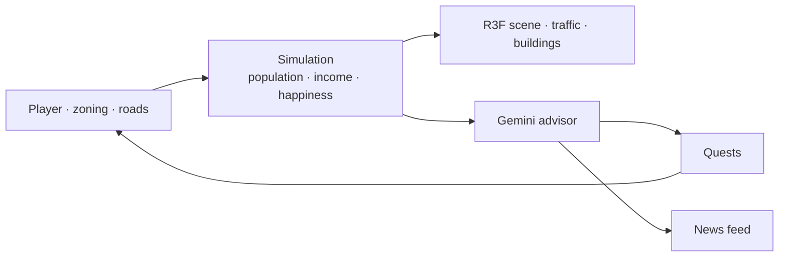

<div align="center">


<p>
  <a href="https://city-verse-gilt.vercel.app"></a>
  
  
  
</p>

<p><em>An isometric 3D city-building simulation where an AI advisor responds to everything you do.<br>
Zone, grow and keep your citizens happy while the news writes itself.</em></p>

</div>


## What it is

Build residential, commercial, industrial and park zones, manage the economy and watch the population grow. Instead of scripted events, a Gemini advisor reads your city's exact state and generates quests, shapes the daily news feed and reacts to swings in citizen morale.

| | |
|---|---|
| **Isometric 3D engine** | Procedurally generated scenes with Three.js and React Three Fiber, with a day and night cycle. |
| **AI advisor** | Real-time goals and news events from your city's statistics. |
| **Dynamic economy** | Population growth, income and happiness simulated together. |
| **Live traffic** | Vehicles drive your road network on their own, with traffic lights at junctions. |
| **Procedural architecture** | Buildings vary in shape, height and detail. |
| **Premium HUD** | A responsive interface with smooth motion. |




## Türkçe özet

**CityVerse**, yapay zekânın hamlelerine anlık tepki verdiği izometrik bir 3B şehir kurma simülasyonu. Konut, ticaret, sanayi ve park alanları kurup ekonomiyi, nüfusu ve vatandaş mutluluğunu yönetiyorsun. Statik olaylar yerine Gemini danışmanı şehrin durumunu okuyup görevler üretiyor ve günlük haber akışını yazıyor. Yollarda trafik canlı akıyor, binalar prosedürel olarak çeşitleniyor.


## Development

```sh
npm install
echo "GEMINI_API_KEY=..." > .env.local
npm run dev
npm run build
```

<div align="center">
<br>
<a href="https://github.com/kutluhangil"></a>
<sub>Every block tells a story.</sub>
</div>
