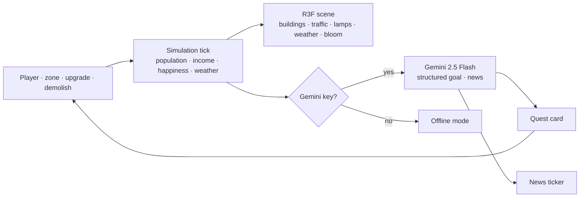

<div align="center">



<p>
  <a href="https://city-verse-gilt.vercel.app"></a>
  
  
  
</p>

<p><em>An isometric 3D city builder where the quests are not scripted: a Gemini advisor reads<br>
your city's numbers and writes the next goal and the day's news.</em></p>

</div>


## The idea

Most city builders ship a fixed list of missions. In CityVerse the advisor looks at your actual city (population, money, happiness, what you have built) and asks Gemini for a goal that fits it, with a target and a reward, plus a news headline that reacts to how things are going. Under that is a compact simulation and a living little world: traffic on your roads, weather, a day and night cycle with street lamps, and procedural buildings that grow as you upgrade them.

> **The AI is a guest, not a requirement.** Without a Gemini key the game runs in offline mode: the simulation, building and weather all work, and the advisor simply stays quiet.


## Features

| | |
|---|---|
| **Zoning** | Roads, residential, commercial, industrial, parks, playgrounds and fountains, each with a cost and an effect on population, income or happiness. |
| **Tools** | Upgrade a building to a taller variant, inspect a tile, or demolish it. |
| **Simulation** | Population growth, income and happiness ticking together; playgrounds and fountains cost upkeep but make people happier. |
| **AI advisor** | Gemini 2.5 Flash returns a structured goal (population, money, building count or happiness), with a target and a reward. |
| **News feed** | Short headlines generated from the city's current state. |
| **Live traffic** | Cars drive the road network, with traffic lights at junctions and pedestrians on the pavements. |
| **Day and night** | A sun that moves, street lamps and windows that light up after dark. |
| **Weather** | Sunny, rainy and snowy spells that change over time, with particles and splashes. |
| **Procedural buildings** | Shapes, heights and details vary per lot; water, trees and road markings fill in the rest. |
| **Post-processing** | Bloom and ambient occlusion with `@react-three/postprocessing`. |
| **HUD** | Funds, population, happiness, weather widget, quest card and news ticker. |


## The buildings

| Zone | Cost | Effect |
|---|---|---|
| Road | $10 | Connects lots and carries traffic |
| Residential | $100 | +5 population |
| Commercial | $220 | +15 income |
| Industrial | $400 | +40 income |
| Park | $50 | +1 population, happier citizens |
| Playground · Fountain | $150 · $250 | Upkeep of 2 · 5 per tick, bigger happiness boost |
| Upgrade | from $100 | A taller, denser version of the building |


## How it fits together




## Türkçe özet

**CityVerse**, izometrik 3B bir şehir kurma oyunu. Yol, konut, ticaret, sanayi ve park alanları kurup binaları yükseltiyorsun; nüfus, gelir ve mutluluk birlikte hesaplanıyor. Görevler önceden yazılmış değil: Gemini danışmanı şehrinin gerçek durumuna bakıp hedefi ve ödülü belirliyor, günün haber başlığını yazıyor. Yollarda trafik ve trafik ışıkları, gece yanan sokak lambaları ve pencereler, güneş, yağmur ve kar var. Gemini anahtarı yoksa oyun çevrimdışı modda sorunsuz çalışıyor.


## Development

```sh
npm install
echo "GEMINI_API_KEY=your-key" > .env.local   # optional
npm run dev
npm run build
```

The key is injected into the client bundle at build time, so restrict it to your domain.

```
App.tsx                 game state, simulation tick, weather, advisor calls
components/IsoMap.tsx   the R3F scene: grid, buildings, roads, traffic, lamps, weather, post-processing
components/UIOverlay    HUD, tools, quest card, news, weather widget
components/StartScreen  the title screen
services/geminiService  structured goals and news events
constants.tsx · types.ts  building configs and game types
```

<div align="center">
<br>
<a href="https://github.com/kutluhangil"></a>
<sub>All rights reserved · the city, quest and headline in the banner are invented.</sub>
</div>
