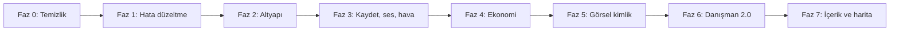

# CityVerse — Yol Haritası

> Son güncelleme: 2026-11-20. Bu dosya `IMPLEMENTATION_PLAN.md` ve `PROJECT_REVIEW.md`'nin yerini alır (ikisi Faz 0'da silinir).
> Her faz kendi başına uygulanır ve doğrulanır; bir faz bitmeden sonrakine geçilmez.

## Kararlar

| Tarih | Karar |
|---|---|
| 2026-11-20 | **Yapay zekâ projeden tamamen çıkarıldı.** `@google/genai`, `services/geminiService.ts`, `GEMINI_API_KEY` enjeksiyonu ve başlangıç ekranındaki AI anahtarı kaldırıldı. Görevler ve haberler `services/advisor.ts` içindeki kural tabanlı danışmandan gelir. Oyun hiçbir anahtar ya da sunucu olmadan çalışır. |
| 2026-11-20 | **Görsel yön: C — Kâğıt Maket / Fildişi.** `fildisi-kagit` tasarım dili (`#f9f9f7` fildişi kâğıt zemin, `#141413` mürekkep, `#d97757` kil turuncusu vurgu, serif + sans + mono tipografi). Faz 5 bu karara göre uygulanır. |

## Genel bakış



---

## Faz 0 — Temizlik

**Amaç:** Kök dizin temiz, isimler tutarlı, `tsc` çalışıyor.

- [x] Kökteki 50 adet `patch_*.cjs`, `fix_*.cjs`, `add_*.cjs`, `remove_pop.cjs`, `update_*.cjs` dosyasını sil (hepsi uygulanmış tek seferlik yamalar; `allowJs` yüzünden `tsc`'yi kırıyorlar).
- [x] `IMPLEMENTATION_PLAN.md` ve `PROJECT_REVIEW.md`'yi sil (bu dosya yerlerini aldı).
- [x] `index.html`: kalan `importmap` bloğunu ve Tailwind CDN'ini kaldır; Tailwind'i PostCSS ile build'e al (`tailwind.config`, `index.css` içine direktifler). `lang` ve meta açıklamasını düzelt.
- [x] `package-lock.json` adını `cityverse` ile eşitle (`npm install --package-lock-only`).
- [x] `IsoMap.tsx` ölü kodu: kullanılmayan importlar (`useTexture`, `Instances`, `Instance`, `Html` gerekirse kalsın), `GridBorder`, `Sway`, `FloatingIncome` (Faz 5'te gerçek gelire bağlanacaksa taşı), boş yorum satırları.
- [x] `BuildingType.Upgrade`'in araç mı yoksa tür mü olduğuna karar ver (bkz. B2).

**Bitti ölçütü:** Kökte yalnız giriş noktası, yapılandırma ve belgeler var; `npx tsc --noEmit` 0 hata; `npm run build` geçer.

---

## Faz 1 — Hata düzeltme

**Amaç:** Denetimde doğrulanan hataların hepsi kapanır; simülasyon test edilebilir hale gelir.

| # | Hata | Durum |
|---|---|---|
| B1 | Oyun hızı iki kez uygulanıyor (`TICK/gameSpeed` + `0.1*gameSpeed`); gün sayacı döngüyle uyumsuzdu. | ✅ Sabit `GLOBAL_TIME_STEP`, `day` döngüye bağlı, `DayNightSystem` akıcı enterpolasyonlu |
| B2 | "Upgrade" aracı boş kareye görünmez `Upgrade` binası koyuyordu. | ✅ `validateUpgrade` yalnız yükseltilebilir karede çalışır |
| B3 | Nüfus ondalıklı gösteriliyordu. | ✅ Gösterimde `Math.floor` |
| B4 | Görev kartı `happiness` hedefini "Pop." gösteriyor; `buildingType` eksikse çökme riski. | ✅ `formatGoalTarget` güvenli etiketleme |
| B5 | `TrafficLight`'ta tek `ref` iki mesh'e bağlı; ışıkların yarısı hiç değişmiyordu. | ✅ `matX` / `matY` materyali paylaşılır ve dispose edilir |
| B6 | Heatmap paneli masaüstünde istatistik çubuğuyla çakışıyordu. | ✅ `dataMode` `App` + `UIOverlay` içine taşındı |
| B7 | Yayalar yollara bağlı değil, haritadan çıkıyor; sonradan eklenenler renksizdi. | ✅ Yürünebilir komşu karelerde kalır, renkler `useEffect` ile atanır |
| B8 | Aşırı kalabalık cezası %90'da sürekli devredeydi. | ✅ %98 eşiği + kademeli hafif ceza |
| B9 | Demolish aracı ile Inspector "Redevelop" farklı iade hesaplıyordu. | ✅ Tek `calculateDemolishRefund` |
| B10 | Render içinde `new THREE.MeshStandardMaterial` / geometri oluşturuluyordu. | ✅ Modül seviyesi önbellekler ve paylaşılan geometriler |
| B12 | 7 TS hatası (`WindowBlock.active`, `motion` variant tipleri). | ✅ Temizlendi |
| B13 | `building_count` hedefi seviye ağırlıklı sayıyordu. | ✅ Gerçek kare adedi sayılır |
| — | Heatmap modunda tıklama sessizce yok sayılıyor. | ✅ "Build tools disabled while Data Overlay is active." uyarısı |

- [x] Simülasyonu saf fonksiyonlara ayır: `sim/tick.ts` (gelir, nüfus, mutluluk, hava), `sim/placement.ts` (yerleştirme kuralları), `sim/refund.ts`.
- [x] Bu fonksiyonlar için Vitest birim testleri.

**Bitti ölçütü:** Tüm B maddeleri kapalı; `vitest` yeşil; 3x hızda güneş tam 3 kat hızlı.

---

## Faz 2 — Altyapı

- [x] ESLint (TypeScript + React hooks kuralları), `npm run lint`.
- [x] Vitest (`npm test`) ve Playwright smoke testi (başlat → yol kur → ev kur → para düşer).
- [x] GitHub Actions: `lint` + `tsc` + `test` + `build`.
- [x] Code-split: `IsoMap` lazy, `three` / `drei` / `postprocessing` ayrı chunk'larda. Hedef: ana chunk < 500 kB.
- [x] `IsoMap.tsx`'i böl: `scene/buildings/`, `scene/traffic/`, `scene/weather/`, `scene/lighting/`, `scene/ground/`.
- [x] `App.tsx`'ten Inspector modalını `components/Inspector.tsx`'e taşı.

**Bitti ölçütü:** CI yeşil; hiçbir dosya 500 satırı geçmiyor; ana chunk < 500 kB.

---

## Faz 3 — Kaydet/Yükle, ses, hava görselleri

- [x] **Kaydet/Yükle:** `2ccfd81` commit'indeki kod referans alınır (`git show 2ccfd81`). Otomatik kayıt (her gün), başlangıç ekranında "Devam et / Yeni şehir / Sil", JSON dışa/içe aktarma. Kayıt şeması sürümlü (`version` alanı).
- [x] **Ses:** `2ccfd81`'deki `utils/audio.ts` (Web Audio ile üretilen sesler) geri gelir. İnşa, yıkım, ödül sesleri; ortam uğultusu; sessize alma düğmesi (localStorage'da).
- [x] **Hava görselleri:** `WeatherParticles` (yağmur/kar + sıçrama), `FogOverlay` ve `Cloud` zaten yazılı ama `EnvironmentEffects` içinde render edilmiyor. Sahneye bağla, parçacık sayısını performansa göre ayarla.

**Bitti ölçütü:** Sayfa yenilendiğinde şehir aynen geri gelir; yağmur ve kar görünür; ses kapatılabilir.

---

## Faz 4 — Ekonomi ve oynanış

- [x] **RCI talebi:** Konut, ticaret ve sanayi talep barları. Nüfus iş ister, iş sanayi ister, ticaret nüfus ister. Talep yoksa bina yavaş dolar.
- [x] **Bütçe:** Vergi oranı kaydırıcısı, bina bakım giderleri, günlük gelir/gider dökümü, iflas uyarısı.
- [x] **Yol bağlantısı:** Bina yalnızca ana yol ağına bağlıysa çalışır (BFS); bağlantısız binada uyarı ikonu.
- [x] **Hizmet binaları:** İtfaiye, polis, okul, hastane, enerji santrali; her birinin etki yarıçapı. Heatmap'e "hizmet kapsamı" katmanı.
- [x] **Havanın ekonomik etkisi:** Kar fabrika verimini, yağmur trafik hızını düşürür.
- [x] **Kilometre taşları:** Köy → Kasaba → Şehir → Metropol. Her kademe yeni binaların kilidini açar; son kademe kazanma ekranı.

**Bitti ölçütü:** Tek bir stratejiyle (ör. "hep fabrika") kazanılamıyor; simülasyon testleri yeni kuralları kapsıyor.

---

## Faz 5 — Görsel kimlik

> Mockup seçimine göre uygulanır.

- [x] **Ortak tasarım dili:** Başlangıç ekranı, HUD ve Inspector aynı token'ları kullanır (renk, köşe yarıçapı, gölge, tipografi). Tailwind tema dosyasında tanımlanır.
- [x] **Arazi:** Ada kenarı, kumsal, göl/nehir kareleri, ağaçlık doğal engeller (silme maliyetli). Altta animasyonlu su shader'ı.
- [x] **Bina çeşitliliği:** Seviyeye göre farklı model (L1 ev → L2 apartman → L3 rezidans), inşaat iskelesi animasyonu, gece pencereler rastgele yanar.
- [x] **Önizleme 2.0:** Geçerli konum yeşil, geçersiz kırmızı + nedeni ("yola bitişik değil", "sanayiye çok yakın"), maliyet etiketi, etki yarıçapı halkası.
- [x] **Oyun hissi:** `FloatingIncome` gerçek gelire bağlanır, para sayacı animasyonlu artar, görev tamamlanınca konfeti + ses.
- [x] **Trafik:** Araç türleri (otobüs, kamyon), gece farlar; yayalar kaldırımda.
- [x] **Kamera:** Kenar kaydırma, 90° döndürme (Q/E), fotoğraf modu (UI gizli + tilt-shift).
- [x] **Grafik ayarı:** Düşük / Orta / Yüksek (N8AO, gölge, parçacık) + FPS göstergesi.

**Bitti ölçütü:** Tüm ekranlar tek stilde; orta seviye bir dizüstünde Yüksek ayarda 60 FPS.

---

## Faz 6 — Danışman 2.0 (kural tabanlı)

- [x] Danışman grid'i analiz eder: kirlilik kümeleri, parksız mahalleler, bağlantısız binalar, hizmet boşlukları. Görev metni sorunun yerini söyler ("Kuzeydoğudaki evlerin parkı yok").
- [x] Görev zincirleri ve kademeli zorluk; aynı türde görevin art arda gelmesini engelle.
- [x] Olay sistemi: rastgele olaylar (yangın, festival, grev) ve hasarlı kareler (`isDamaged` görseli hazır), onarım maliyeti.
- [x] Haber başlıkları şehrin olaylarına bağlanır (yeni bina, kilometre taşı, olay); şablon havuzu genişler.

**Bitti ölçütü:** Görevler şehrin gerçek bir sorununa işaret ediyor; 30 dakikalık oyunda aynı görev metni tekrar etmiyor.

---

## Faz 7 — İçerik ve harita

- [x] Daha büyük harita (32×32 / 48×48) ya da arsa satın alarak genişleme.
- [x] Sürükleyerek yol/bölge boyama; geri al / yinele (Ctrl+Z / Ctrl+Shift+Z).
- [x] Klavye kısayolları (1–9 araçlar, R yol, Del yıkım, Space duraklat).
- [x] Türkçe / İngilizce arayüz.

---

## Doğrulama listesi (her faz sonunda)

```sh
npx tsc --noEmit
npm run lint      # Faz 2'den sonra
npm test          # Faz 1'den sonra
npm run build
```
